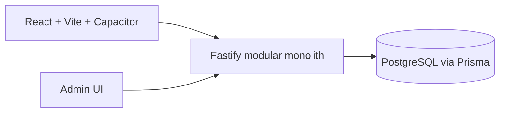

# Architecture

The API enforces JWT authentication, role checks, and business ownership checks. Public discovery only exposes approved businesses. Prices use integer minor units (`priceMinor` / `subtotalMinor`) with explicit ISO currency, never floating point.

Location is provider-neutral: businesses retain address/city/locality/latitude/longitude; a mapping provider may be added behind this representation later. PostgreSQL coordinate indexes support a simple future nearby-query implementation.

Production: reverse proxy terminates HTTPS, API and database run in separate Docker networks, database has no public port. Run migrations during deployment and back up PostgreSQL daily with encrypted off-host retention.
