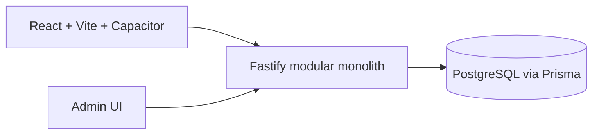

# Architecture

The API enforces JWT authentication, role checks, and business ownership checks. Public discovery only exposes approved businesses. Prices use integer minor units (`priceMinor` / `subtotalMinor`) with explicit ISO currency, never floating point.

Location is provider-neutral: businesses retain address/city/locality/latitude/longitude; a mapping provider may be added behind this representation later. PostgreSQL coordinate indexes support a simple future nearby-query implementation.

## Manual subscription payments (Phase 7B)

Businesses pay their NearbyOrders Business subscription manually (Easypaisa / JazzCash / bank transfer). The flow is deliberately human-verified — there is no self-attestation and no customer payment gateway:

1. Pay-in methods live in the `PaymentMethod` table (account title, number/IBAN, instructions, display order). Admins edit them via `/api/v1/admin/payment-methods`; changing a number never requires a mobile release. Seeded dev/test methods are clearly labelled placeholders, never real accounts.
2. The owner uploads a real receipt image to `POST /api/v1/subscription/payment-receipts` (multipart, 5 MB cap, JPG/PNG/WebP). The server stores bytes under an opaque key (`receipts/<uuid>.<ext>`) in `src/receiptStorage.ts` — the single seam a bucket provider replaces later. Receipts are readable only through `GET .../payment-receipts/:storageKey` by the owning business or an admin; there is no public URL.
3. The owner submits the reference + storage key via `POST /api/v1/businesses/:id/subscription/payment-requests`. The amount is always the server-computed plan price (299900 minor PKR); the client never sends money values. One `PENDING` request per business (advisory-lock guarded), and the owner can cancel their own pending request.
4. An ADMIN reviews the queue (`GET /api/v1/admin/subscription/payment-requests`), views the receipt, then approves or rejects. Approval runs atomically under the same `pg_advisory_xact_lock` pattern as trials and bookings: the request flips to `APPROVED` and the subscription activates in one transaction — a live paid subscription extends from its current expiry, a live trial activates in place, anything else creates a fresh row. A transaction reference can only be approved once across all requests. Rejection requires a reason, leaves the subscription untouched, and notifies the owner; owners are notified on both outcomes and audit-log entries record every review.

Production: reverse proxy terminates HTTPS, API and database run in separate Docker networks, database has no public port. Run migrations during deployment and back up PostgreSQL daily with encrypted off-host retention (receipt files belong in that backup plan too).
